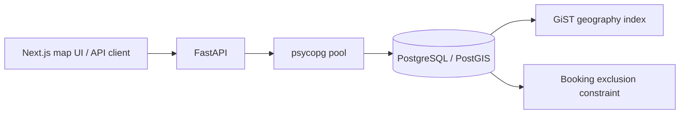

# Architecture decisions

## Transaction authority

FastAPI provides validation and account checks. A psycopg connection pool serves synchronous
handlers. Connections use autocommit for reads; each mutating multi-step handler starts an
explicit transaction and commits before returning a success result. PostgreSQL is authoritative
for reservation exclusivity across every API process.

`no_overlapping_bookings` excludes equal listing IDs with overlapping half-open
`tstzrange(starts_at, ends_at, '[)')` values for held and confirmed bookings. The database waits on
uncommitted conflicts and rejects a loser. The API maps this exclusion violation to HTTP 409.
Back-to-back reservations are valid because the end boundary is excluded. Availability search
is a convenience; its result never guarantees that a later reservation will still succeed.

## Requests, retries and ownership

The server derives the customer from a stored session, not from a request body. A listing's
owner is similarly server-derived. Every account has one role, `customer` or `owner`, chosen
at registration and read from the database on each request (login cannot claim one). Owner
endpoints (listing create/update/delete, images, host views) and customer endpoints
(reserve, booking history, cancel, checkout) are guarded by FastAPI dependencies that return
403 for the wrong role. Within a role, rows are still scoped to the signed-in account: another
owner's listing is a 404, not a 403, so ids are not confirmed to outsiders. Migration 004
promoted existing accounts that already hosted spaces to `owner`.

Reservation retries use a UUID scoped to the customer, with a unique constraint on
`(customer_id, request_id)`. The customer's account row is locked before checking a key,
so concurrent retries across different listings cannot race. The same payload returns the
existing booking; a changed payload returns 409. A retry after cancellation returns the
cancelled booking. Failed transactions do not consume the key.

This serializes a customer's concurrent booking requests. It is a deliberate initial tradeoff,
not a claim of maximum throughput. A shared lock on the listing coordinates reservation with
owner deactivation. Cancellation locks its booking row and atomically changes its status.
Stripe network requests happen outside these transactions. Signed webhooks lock the booking
and atomically store their event ID with the state transition; a durable refund job compensates
late payment or paid cancellation. See [payment boundaries](payments.md).

## Browser and hosting boundary

Next.js exports a static React interface served by the API from the same origin. Leaflet
renders attributed OpenStreetMap tiles; search/list/book/cancel/host operations use the real
API. Browser login returns an HttpOnly cookie and user metadata, never a JavaScript-readable
token. Unsafe browser requests require the configured Origin; non-browser bearer clients
retain the existing API contract. Authentication attempt counters are shared in PostgreSQL.
No Redis dependency is introduced solely for a technology claim: sessions, rate-limit counters
and booking exclusivity all need PostgreSQL's durability or transactions, and search results
depend on live availability, so a cache would add invalidation risk without a measured need.

Compose separates the migration owner from the app/worker role. Maintenance runs independently
and releases expired holds, removes expired sessions/counters, and retries refund jobs.

## Listing lifecycle and images

Owners can edit any listing field with a partial `PATCH`. Bookings keep the total they were
quoted, so a price change affects only new reservations. Every owner mutation first locks the
listing row (`FOR UPDATE`); reservations take `FOR SHARE` on the same row, so edits, image
uploads and deletion serialize against concurrent bookings.

`DELETE /listings/{id}` refuses (409) while held or confirmed reservations have not ended. A
listing that was never booked is removed with its images. A listing with booking history is
archived instead: it becomes inactive, leaves the owner's list, search and detail endpoints,
and loses its images, while both sides' booking history keeps its title and address. A
constraint keeps archived listings inactive. Tests race deletion against reservation and
check that no confirmed booking is left on an inactive listing.

Images are stored in PostgreSQL (`listing_image`, at most six per listing, 2 MiB each) so the
demo stays a single dependency. The type is decided by magic bytes (JPEG, PNG or WebP) and must
match the declared `Content-Type`; SVG and anything else is refused. Images are served with an
immutable cache header, an ETag and a sandboxing CSP. Object storage would replace this table in
a production deployment.

## Location search and money

Coordinates are stored as `geography(Point, 4326)`. `ST_DWithin` uses meters and a partial
GiST index on active listings. Results are ordered by distance and listing ID and bounded
to 100, or by price when `sort=price`. Search excludes confirmed interval conflicts and can
filter by `max_price_cents` and required `features` (a closed vocabulary checked by the
database, with a partial GIN index). Radius is capped at 50 km.
The [recorded synthetic radius-query plan](../evidence/README.md) selects the spatial index.
That benchmark excludes booking availability and distance sorting; the complete endpoint
still needs measurement with representative listing and reservation data.

Prices are integer cents. The server computes the charge from stored hourly price and
elapsed microseconds using decimal arithmetic and rounds up once. The result is stored
on the booking so later pricing changes cannot rewrite its recorded quote.
Intervals are normalized to UTC. The database's 30-day limit compares elapsed duration
to 720 hours, so its outcome does not depend on the connection's timezone or daylight saving.

## Migrations and operation

The migration runner acquires a transaction-scoped advisory lock, verifies previously applied
SHA-256 digests, and applies all pending ordered SQL files in one transaction. Editing an applied
migration fails closed; upgrades require a new numbered file. Connection waits, statements and
locks have timeouts. Recovery, backup restore, connection saturation and multi-instance load
have not yet been exercised. Infrastructure failures are not falsely reported as booking conflicts.
